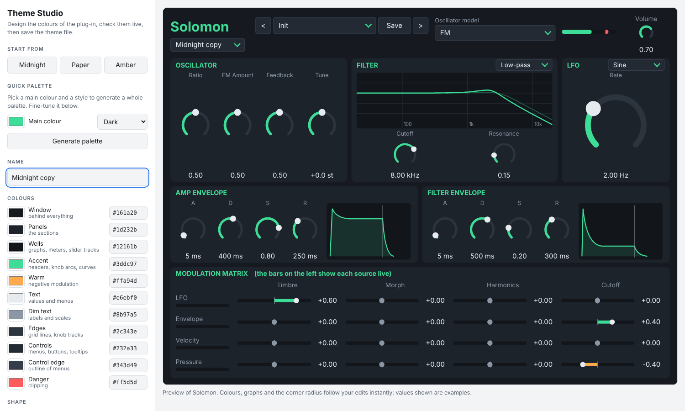

# Theme Studio

A small visual editor for the colour themes of my audio plug-ins. Pick the colours, watch a live preview of the
plug-in, check that the result is readable and download a theme file the plug-in can load. No installation: it is
one HTML page that works offline and sends nothing anywhere.

Supported plug-ins: **[Solomon](https://github.com/ravaninip/Solomon)** (a theme menu is built into the editor).

## Table Of Contents

- [Using the Theme Studio](#using-the-theme-studio)
- [What you can change](#what-you-can-change)
- [Using a theme in a plug-in](#using-a-theme-in-a-plug-in)
- [The theme file](#the-theme-file)
- [Security and privacy](#security-and-privacy)
- [Roadmap](#roadmap)
- [License & Usage guidelines](#license--usage-guidelines)

## Using the Theme Studio

- **Online:** once GitHub Pages is enabled for this repository (Settings → Pages → *Deploy from a branch* →
  `main` / `(root)`) the page is at `https://ravaninip.github.io/ThemeEditorVST/`.
- **Offline:** download this repository (or just `index.html`) and open the file in any modern browser.

Start from a built-in theme or generate a whole palette from one main colour (dark or light), then fine-tune each
colour. The preview on the right updates as you type. When the readability checks are green, press
**Download theme file**.

## What you can change

Eleven colours (window, panels, wells, accent, warm, text, dim text, edges, controls, control edge, danger) and the
corner radius of the panels. Layout editing is not part of this version, see the [roadmap](#roadmap).

## Using a theme in a plug-in

Copy the downloaded `.json` file into the plug-in's themes folder (for Solomon: choose *Open themes folder...* in
its theme menu), then choose *Reload themes*. Details and folder locations are in [docs/THEMES.md](docs/THEMES.md).

## The theme file

A small, versioned JSON file, described in [docs/THEMES.md](docs/THEMES.md) and by the
[JSON Schema](theme.schema.json). Three examples are in [examples](examples).

## Security and privacy

- The page is a single file with no external requests, no tracking and no third-party scripts; themes are
  processed in your browser and never uploaded.
- Files you open are checked with the same rules as the plug-ins use (size, structure, colour format, version).
- Plug-ins treat theme files as untrusted input and refuse unreadable themes, so a theme cannot lock you out of
  the theme menu. See [SECURITY.md](SECURITY.md) for how to report a problem.

## Roadmap

- Drag-and-drop layout editing: move and resize controls, with the result saved in the theme file
- Preview for more plug-ins
- Fonts and control styles

## License & Usage guidelines

- The Theme Studio is free software under the **GNU Affero General Public License v3.0 or later**, see
  [LICENSE](LICENSE).
- Themes you create are yours; the licence of this tool does not apply to them.

### Trademarks

VST is a registered trademark of Steinberg Media Technologies GmbH. This project is not affiliated with or
endorsed by Steinberg.
