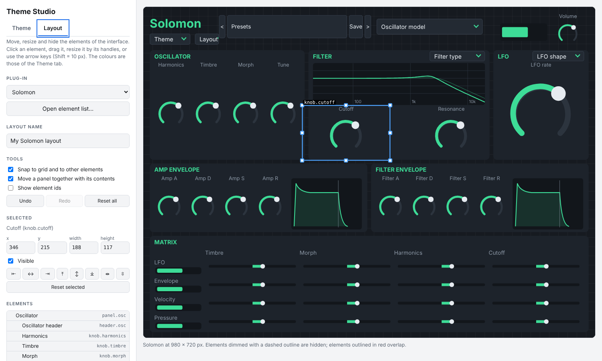

# Theme Studio

A small visual editor for the look of my audio plug-ins. In the **Theme** tab you pick the colours, watch a live
preview of the plug-in, check that the result is readable and download a theme file. In the **Layout** tab you
move, resize and hide every element of the interface and download a layout file. The plug-in loads both. No installation: it is
one HTML page that works offline and sends nothing anywhere.

Supported plug-ins: **[Solomon](https://github.com/ravaninip/Solomon)** (a theme menu is built into the editor).

## Table Of Contents

- [Using the Theme Studio](#using-the-theme-studio)
- [What you can change](#what-you-can-change)
- [The layout editor](#the-layout-editor)
- [Using a theme in a plug-in](#using-a-theme-in-a-plug-in)
- [The theme file](#the-theme-file)
- [Security and privacy](#security-and-privacy)
- [Roadmap](#roadmap)
- [License & Usage guidelines](#license--usage-guidelines)

## Using the Theme Studio

- **Online:** once GitHub Pages is enabled for this repository (Settings → Pages → *Deploy from a branch* →
  `main` / `(root)`) the page is at `https://ravaninip.github.io/ThemeEditorVST/`.
- **Offline:** download this repository (or just `index.html`) and open the file in any modern browser.

Start from a built-in theme or generate a whole palette from one main colour (dark or light), then fine-tune each
colour. The preview on the right updates as you type. When the readability checks are green, press
**Download theme file**.

## What you can change

**Theme tab:** eleven colours (window, panels, wells, accent, warm, text, dim text, edges, controls, control edge,
danger) and the corner radius of the panels.

**Layout tab:** the position, size and visibility of every element of the plug-in's interface.

## The layout editor

- **Drag** an element to move it, drag its **handles** to resize it, or use the **arrow keys** (Shift = 10 px).
  Snapping to a grid and to the edges and centres of other elements can be switched off.
- Moving a **panel** moves its contents with it (optional).
- **Shift-click** (or Ctrl+A) selects several elements; align them (left, centre, right, top, middle, bottom) or
  distribute them evenly.
- **Hide** an element with `H` or the *Visible* box; hidden elements stay on the canvas, dimmed. Elements that would
  hide the controls needed to switch the layout are *locked* and cannot be hidden.
- **Undo / redo** (Ctrl+Z, Ctrl+Y), *Reset selected*, *Reset all*.
- Overlapping elements get a red outline, and the colours of the Theme tab apply to the canvas, so you see theme
  and layout together.
- Only the elements you changed are saved, so a layout keeps working when a plug-in adds controls.

The editor knows a plug-in through its **element list**, a file the plug-in writes about itself (see
[docs/LAYOUTS.md](docs/LAYOUTS.md)). The list for Solomon is built in; use *Open element list…* for another
plug-in.

## Using a theme in a plug-in

Copy the downloaded `.json` file into the plug-in's themes folder (for Solomon: choose *Open themes folder...* in
its theme menu), then choose *Reload themes*. Details and folder locations are in [docs/THEMES.md](docs/THEMES.md).

## The theme file

Small, versioned JSON files: themes ([docs/THEMES.md](docs/THEMES.md), [schema](theme.schema.json)), layouts and
element lists ([docs/LAYOUTS.md](docs/LAYOUTS.md), [layout schema](layout.schema.json),
[element list schema](descriptor.schema.json)). Examples are in [examples](examples).

## Security and privacy

- The page is a single file with no external requests, no tracking and no third-party scripts; themes are
  processed in your browser and never uploaded.
- Files you open (themes, layouts, element lists) are checked with the same rules as the plug-ins use: size, structure,
  version, colour format, safe element ids, rectangles clamped into the window.
- Plug-ins treat theme files as untrusted input and refuse unreadable themes, so a theme cannot lock you out of
  the theme menu. See [SECURITY.md](SECURITY.md) for how to report a problem.

## Roadmap

- Layout presets and a gallery of shared themes and layouts
- Element lists for ChordMate and for the next plug-ins
- Preview for more plug-ins
- Fonts and control styles

## License & Usage guidelines

- The Theme Studio is free software under the **GNU Affero General Public License v3.0 or later**, see
  [LICENSE](LICENSE).
- Themes you create are yours; the licence of this tool does not apply to them.

### Trademarks

VST is a registered trademark of Steinberg Media Technologies GmbH. This project is not affiliated with or
endorsed by Steinberg.
